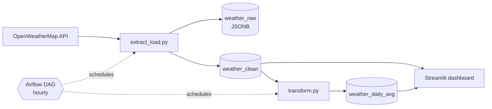
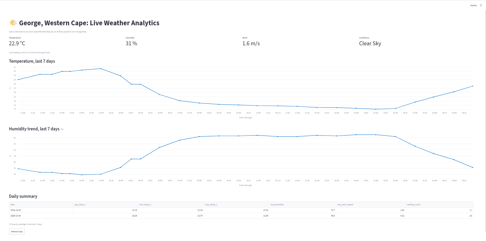
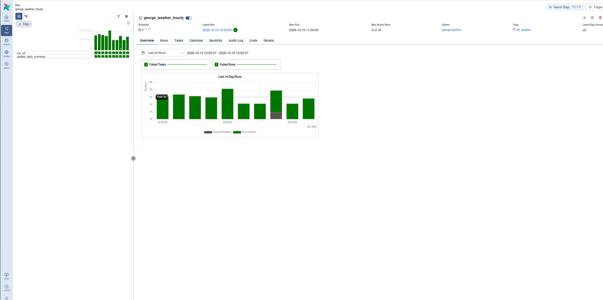

# George Weather Data Pipeline

An end-to-end data pipeline that collects hourly weather data for George, Western Cape, South Africa, stores it in PostgreSQL, summarizes it into daily analytics, and visualizes it in a Streamlit dashboard.

## Problem
Weather APIs give you live data only. There is no easy historical record for George. This pipeline builds that history automatically, one reading per hour.

## Architecture



| Layer | Table | Purpose |
|---|---|---|
| Raw | `weather_raw` | Exact JSON from the API, kept for traceability and reprocessing |
| Clean | `weather_clean` | One validated row per hourly observation (Celsius, humidity, wind, description) |
| Analytics | `weather_daily_avg` | One row per day: average, min and max temperature, humidity, wind |

## Screenshots




## Tech Stack
Python, PostgreSQL 16, Apache Airflow 3, Streamlit, pandas, psycopg2, OpenWeatherMap API

## Project Structure
```
george-weather-data-pipeline/
├── dags/
│   └── george_weather_dag.py     # hourly Airflow DAG: load, then daily summary
├── scripts/
│   ├── extract_load.py           # extract, transform, quality checks, load
│   └── transform.py              # aggregate hourly data into daily averages
├── sql/
│   ├── create_tables.sql         # weather_raw and weather_clean
│   └── create_warehouse.sql      # weather_daily_avg
├── dashboard/
│   ├── app.py                    # Streamlit dashboard
│   └── requirements.txt
├── docs/images/                  # screenshots
├── .env.example
└── requirements.txt
```

## Design decisions
- **Raw and clean layers (medallion-style):** the raw JSON is stored untouched, so cleaning logic can change later without losing source data.
- **Data quality in two places:** Python checks temperature, humidity and wind ranges before loading, and the database enforces its own rules (unique city and time, humidity between 0 and 100, non-negative wind).
- **Idempotent loads:** `ON CONFLICT` makes retries and reruns safe, so duplicate readings never appear in the clean table.
- **Airflow:** hourly schedule, 3 retries with a 5-minute delay, and `catchup=False` because weather is live data that can't be backfilled.
- **Local time for analytics:** daily summaries are grouped by `Africa/Johannesburg` dates so "today" matches George's calendar day, not UTC.
- **Secrets stay out of code:** credentials live in a git-ignored `.env` file.
- **OLTP vs OLAP:** `weather_clean` is the transactional side (many small validated inserts), and `weather_daily_avg` is the analytical side (pre-aggregated for fast reads).

## Setup

**1. Database (Ubuntu)**
```bash
sudo apt install postgresql postgresql-contrib
sudo -u postgres psql -c "CREATE DATABASE weather;"
sudo -u postgres psql -d weather -f sql/create_tables.sql
sudo -u postgres psql -d weather -f sql/create_warehouse.sql
sudo -u postgres psql -c "CREATE USER weather_user WITH PASSWORD 'your_password';"
sudo -u postgres psql -d weather -c "GRANT ALL ON ALL TABLES IN SCHEMA public TO weather_user;"
sudo -u postgres psql -d weather -c "GRANT ALL ON ALL SEQUENCES IN SCHEMA public TO weather_user;"
```

**2. Python environment and settings**
```bash
python3 -m venv .venv && source .venv/bin/activate
pip install -r requirements.txt
cp .env.example .env     # then fill in your OpenWeatherMap key and DB password
```

**3. Run the pipeline once**
```bash
python scripts/extract_load.py
python scripts/transform.py
```

**4. Automate with Airflow**
```bash
AIRFLOW_VERSION=3.3.1
PYTHON_VERSION=3.12
pip install "apache-airflow==${AIRFLOW_VERSION}" \
  --constraint "https://raw.githubusercontent.com/apache/airflow/constraints-${AIRFLOW_VERSION}/constraints-${PYTHON_VERSION}.txt"
airflow db migrate
export AIRFLOW__CORE__DAGS_FOLDER=$PWD/dags
airflow standalone
```
Open http://localhost:8501-style Airflow UI at http://localhost:8080, unpause `george_weather_hourly`, and it runs every hour.

**5. Dashboard** (separate environment, to avoid dependency clashes with Airflow)
```bash
cd dashboard
python3 -m venv .venv && source .venv/bin/activate
pip install -r requirements.txt
streamlit run app.py
```

## Status
Working end to end locally: hourly collection, daily summaries and dashboard.

## Roadmap
- Containerize with Docker Compose (Postgres, Airflow, dashboard)
- Host the database and dashboard for a public link
- Failure alerts by email or Slack
- Automated tests for the transform and quality checks
- More Western Cape locations
